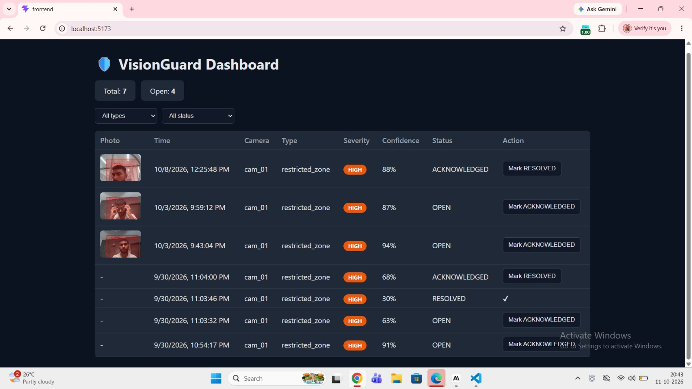

# 🛡️ VisionGuard

Real-time AI surveillance system that detects **restricted zone intrusions** and **falls** from a camera feed and shows live alerts on a web dashboard.



## Features

- 🚨 **Restricted zone detection**: flags a person entering a marked zone (YOLOv8 + object tracking)
- 🧍 **Fall detection** (experimental): flags a sudden standing-to-lying change
- 📸 **Evidence photo** saved automatically for every incident
- 📊 **Live dashboard**: auto-refreshes every 3 seconds, no manual reload
- 🔔 **Alert banner + beep** on new HIGH/CRITICAL incidents
- ✅ **Incident workflow**: OPEN → ACKNOWLEDGED → RESOLVED
- ⏱️ **Cooldown logic** to avoid duplicate alerts for the same person

## Tech Stack

| Layer | Tech |
|-------|------|
| Detection | Python, YOLOv8 (Ultralytics), OpenCV |
| Backend | FastAPI, SQLAlchemy, SQLite |
| Frontend | React, Vite |

## How it works

```
Camera → YOLOv8 detection + tracking → FastAPI backend → Database → React dashboard → Alert
```

## Setup

### 1. Backend

```bash
cd backend
python -m venv venv
venv\Scripts\activate        # Windows
pip install -r requirements.txt
uvicorn app.main:app --reload --port 8000
```

Copy `.env.example` to `.env` and fill in your values.

### 2. Frontend

```bash
cd frontend
npm install
npm run dev
```

Open `http://localhost:5173`

### 3. Run detection (new terminal)

```bash
cd backend
venv\Scripts\activate
python -m app.restricted_zone     # restricted zone detection
python -m app.fall_detection      # fall detection (experimental)
```

Press `Q` in the camera window to quit.

## Project Structure

```
visionguard/
├── backend/     # FastAPI API + detection scripts
├── frontend/    # React dashboard
├── docs/        # Screenshots
└── docker-compose.yml
```

## Author

**Prahalad Sah**: [GitHub](https://github.com/sahprahalad754-cmd)